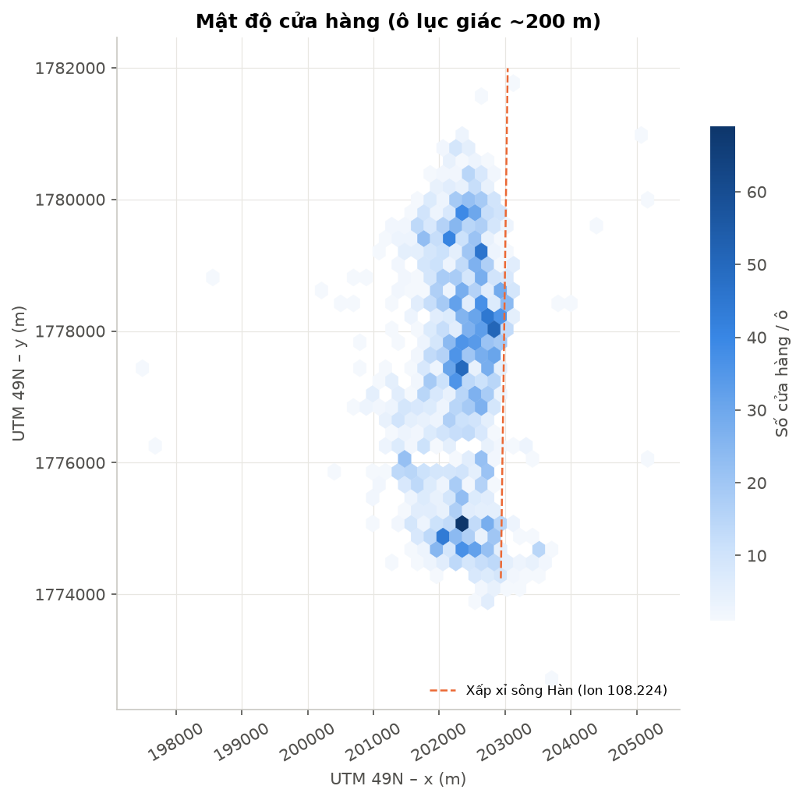
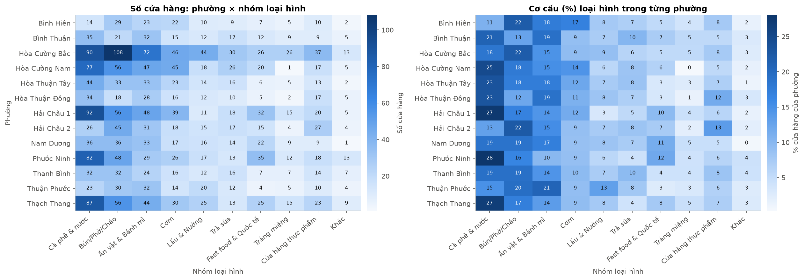
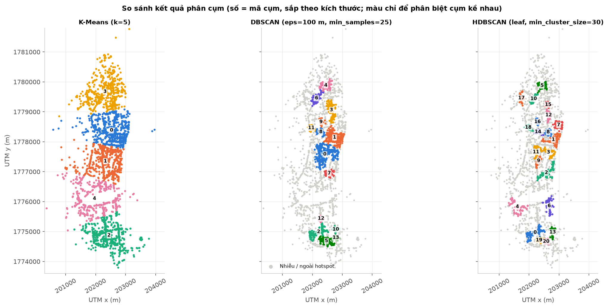
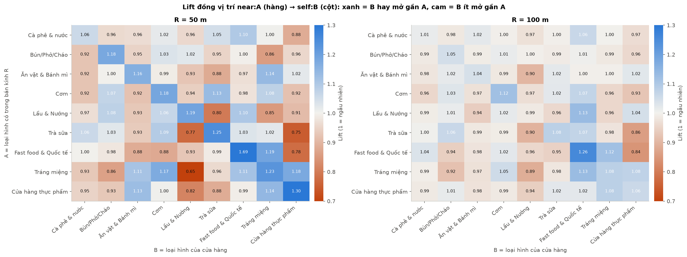
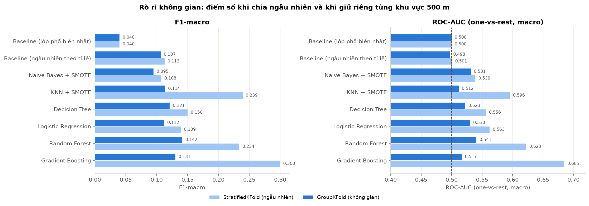
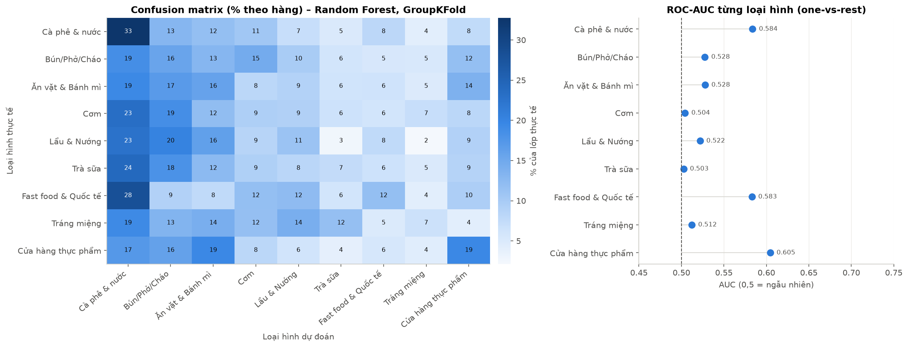
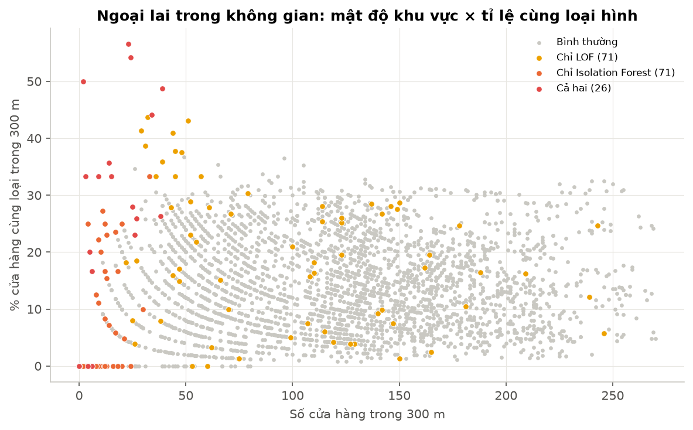

# Khai phá dữ liệu không gian các cửa hàng F&B quận Hải Châu

**Phân cụm điểm nóng, luật kết hợp đồng vị trí và dự đoán loại hình phù hợp với vị trí**

Môn: DAM501 – Data Mining / Data Science · Dữ liệu: 3.256 cửa hàng F&B trên GrabFood/GrabMart, Q. Hải Châu, Đà Nẵng

> Báo cáo được tổ chức theo quy trình **Data Science Methodology**: Problem definition → Analytic approach → Data requirements → Data collection → Data understanding → Data preprocessing → Model → Evaluation → Deployment → Feedback.
> Mọi con số trong báo cáo đều lấy từ output đã chạy của các notebook `00`–`06`. Hình nằm ở `outputs/figures/`, bảng ở `outputs/tables/`.

---

## Tóm tắt

- Sau tiền xử lý còn **3.208 cửa hàng** (FOOD 2.976, SHOP 232). Ba nhóm Cà phê & nước, Bún/Phở/Cháo, Ăn vặt & Bánh mì chiếm khoảng 55%.
- Cửa hàng phân bố **liên tục** dọc trục Bắc–Nam phía Tây sông Hàn, nên DBSCAN với eps ≥ 150 m bị nối chuỗi thành một cụm. Với ngưỡng "≥ 25 quán trong 100 m", DBSCAN tìm được **14 hotspot** chứa 51,4% cửa hàng, tập trung trên các trục Hoàng Diệu, Lê Hồng Phong – Trần Quốc Toản, Phan Đăng Lưu – Lê Thanh Nghị, Nguyễn Chí Thanh.
- Luật trong cửa hàng mạnh (lift 4–6, ví dụ *Lẩu & Nướng + Cơm → Bún/Cháo*, confidence 0,81). Ngược lại, **luật đồng vị trí yếu** (lift 0,84–1,97). Quy luật rõ nhất là **quán cùng loại tụ lại gần nhau** ở cự ly 50 m: Fast food & Quốc tế lift 1,69; Cửa hàng thực phẩm 1,30; Trà sữa 1,25.
- Mô hình dự đoán loại hình chỉ từ môi trường xung quanh đạt **F1-macro 0,142, ROC-AUC 0,541** khi đánh giá trên khu vực chưa thấy (GroupKFold theo ô 500 m), tốt hơn baseline (F1 0,040–0,107; AUC 0,50) nhưng yếu.
  Nếu chia train/test ngẫu nhiên, điểm số bị thổi phồng tới F1 0,300 / AUC 0,685. Đây là minh chứng của **rò rỉ không gian**.
- Sản phẩm: tệp dữ liệu đã phân tích `stores_analyzed.csv`, điểm gợi ý cho 233 ô 200 m × 9 loại hình kèm bản đồ, công cụ dòng lệnh `src/recommend.py`, và GeoJSON để tích hợp web. Phát hiện ngoại lai (LOF và Isolation Forest đồng thuận ở 26 cửa hàng) tìm ra cả vị trí kinh doanh đặc biệt (Đảo Xanh) lẫn lỗi tọa độ còn sót.

---

## 1. Problem definition – Định nghĩa bài toán

**Câu hỏi chính:** *tại một vị trí cho trước ở Hải Châu, nên mở loại hình F&B nào cho phù hợp với môi trường kinh doanh xung quanh?*

**Câu hỏi phụ:**
1. Cửa hàng tập trung ở đâu, có những hotspot nào, mỗi hotspot có đặc trưng gì?
2. Loại hình nào thường mở cạnh nhau, loại nào "né" nhau?
3. Với một loại hình cho trước, nên mở ở ô nào?

**Tiêu chí thành công:**
- Mô hình tốt hơn baseline khi đánh giá trên khu vực mới.
- Có danh sách vị trí gợi ý kèm căn cứ.
- Có tệp dữ liệu đã phân tích để bàn giao.

## 2. Analytic approach – Hướng tiếp cận

| Câu hỏi | Loại bài toán | Kỹ thuật |
|---|---|---|
| Hotspot ở đâu? | Mô tả – phân cụm không gian | K-Means (trên UTM 49N), DBSCAN (haversine), HDBSCAN |
| Loại hình nào đi cùng nhau? | Mô tả – luật kết hợp | Apriori, FP-Growth (transaction theo cửa hàng / lưới / lân cận) |
| Vị trí hợp loại hình nào? | Dự đoán – phân lớp 9 lớp | Decision Tree, Naive Bayes, KNN, Logistic Regression, Random Forest, Gradient Boosting |
| Cửa hàng nào lạc loài? | Phát hiện ngoại lai | LOF, Isolation Forest |
| Nên mở ở đâu? | Đề xuất | Điểm ô lưới = nhu cầu + ít cạnh tranh + lift đồng vị trí + mô hình |

**Vì sao không dự đoán rating?** Đề cương ban đầu đề xuất dự đoán rating. Sau bước Data understanding, mục tiêu được đổi (xem mục 10) vì hai lý do:
- chỉ 51,8% cửa hàng có rating;
- trường `flag` chỉ được *giả định* là rating × 10.

## 3. Data requirements – Yêu cầu dữ liệu

| Cần | Có? |
|---|---|
| Vị trí (tọa độ, địa chỉ, phường) | ✅ có nhiễu: tọa độ sai tỉnh, trường `ward` mâu thuẫn với địa chỉ |
| Loại hình | ✅ `category`, `productType` đa nhãn (51 nhãn thô) |
| Chất lượng (rating, số lượt đánh giá) | ⚠️ chỉ có `flag`; không có số lượt đánh giá |
| Giá, doanh thu, giờ mở cửa | ❌ |
| Dân số, văn phòng, trường học, giá thuê | ❌ |

## 4. Data collection – Thu thập dữ liệu

- **Nguồn chính:** `data/raw/DaNangData.json`, gồm 3.256 bản ghi × 11 trường, crawl từ nền tảng GrabFood/GrabMart. File gốc không bị sửa.
- **Nguồn bổ sung (đã chuẩn bị, chưa chạy):** `src/scrape_gmaps.py` cào trang danh sách Google Maps theo lưới 500 m, để lấy rating thật và loại hình theo Google.
  Khảo sát thực tế cho thấy mỗi truy vấn trả tối đa khoảng 120 kết quả, zoom 17 cho kết quả gọn nhất (90% nằm trong khoảng 800 m), và người dùng chưa đăng nhập không xem được số lượt đánh giá.
  Việc cào giao diện web trái Điều khoản dịch vụ của Google, nên chỉ dùng cho học tập.

## 5. Data understanding – Hiểu dữ liệu

Khảo sát dữ liệu thô (notebook 01, mục 1) và EDA sau làm sạch (notebook 02).

**Các vấn đề phát hiện trên dữ liệu thô:**

| Trường | Phát hiện |
|---|---|
| `district` | 20 biến thể của "Hải Châu" (khoảng trắng, Unicode tổ hợp, viết hoa/thường). Có 2 bản ghi "Quận Hải An" thực chất ở **Hải Phòng** (Đằng Hải, Cát Bi) |
| `ward` | Dạng "Da Nang – X Ward of Y District", **thiếu hẳn** phường Phước Ninh và Bình Hiên. Chỉ khớp 48,5% với phường ghi trong địa chỉ, nhiều khả năng là kết quả reverse-geocode |
| tọa độ | 6 điểm ngoài bbox Hải Châu +1 km (TP.HCM, Hải Phòng/Quảng Ninh, Liên Chiểu) |
| `productType` | 51 nhãn, trong đó có 4 nhãn **huy hiệu Grab** (Tạp Dề Bạc/Vàng, Deluxe by Grab, Official Brand Store) và các nhãn con trùng nghĩa ("Noodles" + "Noodles & Congee") |
| `flag` | 0 chiếm 48,4%; các giá trị khác là số nguyên 30–45 (mode 40), **không có giá trị > 45** |
| trùng lặp | 64 listing thuộc 32 nhóm trùng (cùng tên, tọa độ, địa chỉ, khác `storeId`) |

**Kết quả EDA chính** (notebook 02; hình `02_*.png`):

1. Cơ cấu loại hình: Cà phê & nước 21,4%, Bún/Phở/Cháo 18,3%, Ăn vặt & Bánh mì 15,3%, Cơm 10,6%, Lẩu & Nướng 7,3%, Cửa hàng thực phẩm 7,2%, Fast food & Quốc tế 6,9%, Trà sữa 6,7%, Tráng miệng 3,7%. FOOD : SHOP ≈ 12,8 : 1.
2. **Hai cực mật độ:** khu trung tâm cũ phía Bắc (Hải Châu 1, Thạch Thang, Phước Ninh) và Hòa Cường Bắc/Nam phía Nam. 40,4% cửa hàng cách sông dưới 500 m.
3. 10/318 tuyến đường chứa 37,4% cửa hàng: Hoàng Diệu (189), Núi Thành (146), Trưng Nữ Vương (142), Đống Đa (121), Lê Thanh Nghị (115).
4. Cơ cấu loại hình khác nhau giữa các phường (χ², p ≈ 6·10⁻⁸). Khu trung tâm có tỉ lệ cà phê 27–28%, trong khi Bình Hiên và Hải Châu 2 chỉ 11–13%. Hải Châu 2 có 13% cửa hàng thực phẩm (chợ Cồn).
5. Rating (giả định) khác nhau có ý nghĩa giữa các nhóm loại hình (Kruskal–Wallis p ≈ 2·10⁻²⁴), nhưng chênh lệch nhỏ: Lẩu & Nướng 4,25 so với Cửa hàng thực phẩm 3,80. Chuỗi có rating thấp hơn quán độc lập (4,07 so với 4,13; p ≈ 3·10⁻⁵).




## 6. Data preprocessing – Tiền xử lý

| Bước | Trước → sau | Số bản ghi bị ảnh hưởng | Ghi chú |
|---|---|---|---|
| Chuẩn hóa chuỗi (NFC, strip, khoảng trắng) | 3.256 → 3.256 | 118 | |
| Chuẩn hóa `district` | 3.256 → 3.256 | 2.238 | 20 biến thể → 1; 12 bản ghi được gắn cờ quận/tỉnh khác |
| Tách phường (`ward_final`) | 3.256 → 3.256 | 1.341 mâu thuẫn | ưu tiên phường trong địa chỉ (so khớp mờ, cutoff 0,85) |
| Loại tọa độ ngoài bbox +1 km và địa chỉ quận khác | 3.256 → **3.240** | 16 | 6 ngoài bbox, 10 có địa chỉ ghi rõ quận/tỉnh khác |
| `productType` đa nhãn | 3.240 | 212 | 51 nhãn → 20 nhãn → 9 nhóm chính (`type_group`) |
| `flag` → `rating`, `has_rating` | 3.240 | 1.568 không có rating | **giả định** rating = flag / 10 |
| Khử trùng listing | 3.240 → **3.208** | 32 | gộp nhãn, rating lấy trung bình |
| Phát hiện chuỗi | 3.208 | 705 thuộc chuỗi | 274 brand có ≥ 2 địa điểm; loại 83 tên món chung chung và 20 sạp chợ |

**Hai lưu ý phương pháp:**
- **Hệ chiếu:** Đà Nẵng (kinh độ khoảng 108,2°E) thuộc **UTM zone 49N (EPSG:32649)**, không phải 48N. K-Means và mọi phép đo khoảng cách Euclid đều dùng UTM 49N, đơn vị mét.
- **Đặc trưng không gian** (notebook 05): đếm số quán theo từng nhóm trong 50/100/300/500 m bằng BallTree haversine, **loại chính điểm đó**. Ngoài ra còn tỉ lệ chuỗi và rating trung bình khu vực, khoảng cách tới quán gần nhất, tới sông Hàn (xấp xỉ kinh tuyến 108,224) và tới tâm hotspot, cùng phường. Tổng cộng **65 đặc trưng**.

## 7. Model

### 7.1. Phân cụm điểm nóng (notebook 03)

**K-Means:**
- Silhouette cao nhất ở k = 2 (0,573), tức chỉ tách cực Bắc và cực Nam.
- Ta yêu cầu k ≥ 5 và chọn **k = 5** (Silhouette 0,422, trùng vùng khuỷu của Elbow).
- K-Means chỉ chia quận thành 5 dải có kích thước tương đương (408–790 cửa hàng), không phát hiện được điểm nóng.

**DBSCAN (haversine, `eps = mét / 6.371.000`):**
- Đường k-distance tăng đều, không có khuỷu sắc.
- Quét tham số cho thấy với eps ≥ 150 m và min_samples từ 5 đến 15, một cụm nuốt 66–99% điểm (**chaining**).
- Chọn **eps = 100 m, min_samples = 25**, nghĩa là *lõi hotspot = ≥ 25 quán trong bán kính 100 m*, tương đương khoảng 8 quán/ha. Kết quả: 14 hotspot, cụm lớn nhất chỉ 11,9%, 48,6% điểm "ngoài hotspot".

**HDBSCAN (`leaf`, min_cluster_size = 30):** 21 cụm, khớp với DBSCAN ở 73% cửa hàng (ARI 0,38).

| Thuật toán | Số cụm | % nhiễu | Silhouette* | Davies–Bouldin* | % điểm ở cụm lớn nhất |
|---|---|---|---|---|---|
| K-Means (k=5) | 5 | 0 | 0,422 | 0,815 | 24,6 |
| DBSCAN (100 m, 25) | 14 | 48,6 | 0,438 | 0,606 | 11,9 |
| HDBSCAN (leaf, 30) | 21 | 56,4 | 0,539 | 0,559 | 5,7 |

\*Silhouette và Davies–Bouldin của DBSCAN/HDBSCAN chỉ tính trên các điểm không nhiễu, nên thiên lạc quan.

**Các hotspot lớn nhất:**

| # | Số quán | Phường | Loại chủ đạo | Tuyến đường |
|---|---|---|---|---|
| 0 | 382 | Nam Dương | Bún/Phở/Cháo 20% | Hoàng Diệu, Huỳnh Thúc Kháng, Lê Đình Dương |
| 1 | 299 | Phước Ninh | Cà phê 23% | Lê Hồng Phong, Trần Quốc Toản, Thái Phiên |
| 2 | 198 | Hòa Cường Bắc | Bún/Phở/Cháo 22% | Phan Đăng Lưu, Lê Thanh Nghị |
| 3 | 142 | Hải Châu 1 | Cà phê 28% | Nguyễn Chí Thanh, Quang Trung, Lê Lợi |
| 11 | 38 | Hải Châu 2 | Cửa hàng thực phẩm 42% | quanh chợ Cồn |

**Nhận xét về hotspot:**
- Rating trong và ngoài hotspot không khác nhau (4,13 so với 4,11; p = 0,12).
- Phân cụm 13 phường theo cơ cấu loại hình (Ward linkage) cho 2 nhóm, nhưng Silhouette chỉ 0,25: nhóm "ít cà phê, nhiều bún/phở" và nhóm còn lại.



### 7.2. Luật kết hợp (notebook 04)

**(a) Trong cửa hàng** (min_support 0,005, tức ≥ 16 quán; min_confidence 0,3): 4 luật.
- *Fast Food → International Food* (lift 6,2).
- *Cơm + Bún/Cháo → Lẩu & Nướng* (lift 5,4).
- *Lẩu & Nướng + Cơm → Bún/Cháo* (confidence 0,81, lift 3,8).

Các luật này mô tả **quán ăn gia đình / quán nhậu đa món**.

**(b1) Lưới 200 m** (min_support 0,10; min_confidence 0,7; tối đa 2 điều kiện ở vế trái): 191 luật, lift tối đa 1,68.
- Các ô chứa vế trái đông gấp khoảng 2 lần ô trung bình, và số quán trong ô tương quan với số loại hình (r = 0,82).
- Vì vậy luật lưới **phản ánh mật độ** nhiều hơn là quan hệ thật giữa các loại hình.

**(b2) Lân cận lấy cửa hàng làm tâm** (Koperski & Han):
- Mỗi cửa hàng là một transaction gồm `self:<loại>` và `near:<loại trong R>`; chỉ giữ các luật `near → self`.
- Chọn ngưỡng: min_support 0,01, lift ≥ 1,2. Confidence không phù hợp làm ngưỡng chính vì P(self) chỉ 3,7–21%.

Kết quả:
- **Quán cùng loại tụ lại gần nhau** (lift đường chéo ở R = 50 m): Fast food & Quốc tế 1,69; Cửa hàng thực phẩm 1,30; Trà sữa 1,25; Tráng miệng 1,23; Cơm và Bún/Phở 1,18. Cà phê chỉ 1,06, vì cà phê có ở khắp nơi.
- Fast food và Tráng miệng hút nhau theo cả hai chiều (1,12–1,13 ở 100 m).
- **Né nhau:** Cửa hàng thực phẩm né Fast food (0,84) và Trà sữa (0,86); Lẩu & Nướng né Trà sữa (0,90) và Tráng miệng (0,89).
- **Luật hiển nhiên:** X → near:Cà phê có confidence ≥ 0,93 nhưng lift chỉ 0,97–1,09. Vì vậy phải xếp hạng theo lift và conviction, không theo confidence.

**Apriori và FP-Growth:**
- Hai thuật toán luôn cho cùng số tập phổ biến.
- Trên dữ liệu nhỏ, Apriori của mlxtend (vector hóa bằng numpy) nhanh hơn: 2–9 ms so với 3–19 ms.
- FP-Growth chỉ nhanh hơn khi số tập phổ biến lớn: 162 ms so với 211 ms khi có 8.157 tập.



### 7.3. Dự đoán loại hình theo vị trí (notebook 05)

- **Nhãn:** 9 nhóm `type_group`, gồm 3.130 cửa hàng (bỏ nhóm "Khác").
- **Đặc trưng:** 65 đặc trưng ngữ cảnh. Không dùng thông tin của chính cửa hàng; không dùng tọa độ thô, vì cây quyết định sẽ học thuộc từng khu phố.
- **Siêu tham số** chọn theo F1-macro dưới GroupKFold: Decision Tree max_depth = 12, KNN k = 5, Random Forest min_samples_leaf = 5.
- **Mất cân bằng lớp:** dùng `class_weight="balanced"`. Riêng KNN và Naive Bayes dùng **SMOTE đặt trong pipeline**.

## 8. Evaluation – Đánh giá

| Mô hình | F1-macro (ngẫu nhiên) | F1-macro (**không gian**) | Balanced acc. (không gian) | Top-3 (không gian) | ROC-AUC (không gian) |
|---|---|---|---|---|---|
| Baseline – lớp phổ biến nhất | 0,040 | 0,040 | 0,111 | 0,415 | 0,500 |
| Baseline – ngẫu nhiên theo tỉ lệ | 0,113 | 0,107 | 0,107 | 0,320 | 0,498 |
| Naive Bayes + SMOTE | 0,108 | 0,095 | 0,136 | 0,372 | 0,531 |
| KNN + SMOTE | 0,239 | 0,114 | 0,123 | 0,391 | 0,512 |
| Decision Tree | 0,150 | 0,121 | 0,145 | 0,375 | 0,523 |
| Logistic Regression | 0,139 | 0,112 | 0,134 | 0,383 | 0,530 |
| **Random Forest** | 0,234 | **0,142** | **0,144** | **0,460** | **0,541** |
| Gradient Boosting | 0,300 | 0,131 | 0,131 | 0,433 | 0,517 |

"Ngẫu nhiên" là StratifiedKFold 5 fold; "không gian" là GroupKFold 5 fold theo ô lưới 500 m (79 ô).

**Kết luận đánh giá:**
1. **Rò rỉ không gian là có thật và lớn.** Gradient Boosting mất 0,17 F1 khi chuyển sang CV không gian, KNN mất 0,13, Random Forest mất 0,09. Các mô hình linh hoạt "nhớ" quan hệ giữa những quán sát vách nhau.
2. **Random Forest tốt nhất trên khu vực mới**, nhưng chỉ hơn baseline một khoảng nhỏ (AUC 0,541).
   - Theo F1, dễ đoán nhất là Cà phê & nước (0,32).
   - Theo AUC, phân biệt tốt nhất là Cửa hàng thực phẩm (0,61), Cà phê và Fast food (khoảng 0,58).
   - Trà sữa, Tráng miệng và Cơm gần như ngẫu nhiên (AUC ≈ 0,50–0,51).
3. **Permutation importance theo nhóm** (trên fold test của GroupKFold): cơ cấu 300 m quan trọng nhất (ROC-AUC giảm 0,012), sau đó là cơ cấu 50 m (0,006) và các khoảng cách (0,003). Mật độ, phường và hotspot gần như bằng 0. Độ lệch chuẩn giữa các fold lớn, nên thứ hạng này chỉ mang tính gợi ý.
4. **Ý nghĩa:** thị trường F&B Hải Châu **trộn lẫn**, môi trường xung quanh chỉ gợi ý nhẹ loại hình nên mở. Kết quả này nhất quán với lift đồng vị trí thấp ở mục 7.2.




## 9. Deployment – Triển khai

### 9.1. Sản phẩm bàn giao

| Sản phẩm | Nội dung |
|---|---|
| **`data/processed/stores_analyzed.csv`** (3.208 × 42) | Mỗi cửa hàng gồm: thuộc tính đã làm sạch, nhóm loại hình, hotspot DBSCAN / cụm HDBSCAN / K-Means / cụm phường, bối cảnh không gian (mật độ, đối thủ cùng loại trong 300 m, khoảng cách), dự đoán OOF (`pred_type`, `pred_top3`, `best_fit_type`, `own_type_suitability`), cờ ngoại lai. Từ điển dữ liệu: `stores_analyzed_dictionary.csv` |
| `outputs/tables/grid_recommendations.csv` | Điểm của 233 ô 200 m × 9 loại hình, kèm 4 thành phần điểm |
| `outputs/tables/06_top5_cells_per_type.csv` | Top-5 ô cho từng loại hình |
| `outputs/maps/06_recommend_<loại>.html` | Bản đồ gợi ý cho 9 loại hình; `hotspots.html`, `06_outliers.html` |
| `outputs/maps/*.geojson` | `stores_analyzed`, `hotspots`, `grid_recommendations`, để tích hợp React/Leaflet |
| `outputs/models/type_model.joblib` | Random Forest đã huấn luyện, kèm danh sách đặc trưng |
| `src/recommend.py` | Công cụ dòng lệnh (xem 9.3) |

### 9.2. Ngoại lai (LOF, Isolation Forest)

Đặc trưng dùng: mật độ 100/300 m (log), khoảng cách tới quán gần nhất, khoảng cách tới sông, tỉ lệ cùng loại trong 300 m, số loại hình trong 300 m. Contamination đặt 3%.

- Mỗi thuật toán gắn cờ 97 cửa hàng; **26 cửa hàng bị cả hai gắn cờ**. Tương quan hạng giữa hai điểm số là Spearman 0,58.
- Lý do chính (theo Isolation Forest): khu vực đơn điệu, ít loại hình (69); rất thưa trong 100 m (19); xa trung tâm (9).
- Ví dụ ngoại lai:
  - các quán ở **Đảo Xanh** (The Veranda Grill – Grand Mercure, Nơm Bistro, Hoa Lúa Chay): khu biệt thự, ít quán xung quanh;
  - các quán **sai tọa độ**: "Mạnh Phố Cổ" ghi địa chỉ 68 Pasteur (Hải Châu 1) nhưng tọa độ nằm ở Cẩm Lệ, cách quán gần nhất khoảng 1 km.

  Như vậy phát hiện ngoại lai vừa tìm ra **vị trí kinh doanh đặc biệt**, vừa tìm ra **lỗi dữ liệu còn sót**.



### 9.3. Gợi ý vị trí theo loại hình

**Điểm ô 200 m:**

> Điểm = 0,35 · nhu cầu + 0,30 · ít cạnh tranh + 0,15 · hỗ trợ đồng vị trí + 0,20 · mô hình

| Thành phần | Đo bằng |
|---|---|
| nhu cầu | hạng phân vị của số quán trong 300 m |
| ít cạnh tranh | 1 − hạng của **tỉ lệ** quán cùng loại trong 300 m |
| hỗ trợ đồng vị trí | lift `near → self`, trung bình theo cơ cấu xung quanh |
| mô hình | P(loại \| vị trí) / P̄(loại), lấy từ xác suất OOF |

Trọng số được chọn theo độ tin cậy của từng nguồn: mô hình và luật đồng vị trí yếu, nên nhận trọng số thấp hơn.

**Hai lần sửa trong quá trình triển khai:**
- **Lệch phân phối.** Ban đầu ô được chấm tại tâm ô. Tâm ô thường rơi giữa khối nhà: trung vị 1 quán trong 50 m (so với 5 quán ở vị trí cửa hàng thật), cách quán gần nhất 38 m (so với 12 m).
  Phiên bản cuối chấm theo **trung bình bối cảnh của các vị trí mặt tiền có thật trong ô**, dùng xác suất OOF GroupKFold. Sau khi sửa, chỉ số phù hợp trung bình theo loại hình trên các ô là 0,92–1,06, tức không còn lệch.
- **Mốc so sánh của chỉ số phù hợp.** Ban đầu P(c | x) được chia cho tỉ lệ nền thật. Vì mô hình dùng `class_weight="balanced"`, cách này thổi phồng các lớp hiếm. Phiên bản cuối chia cho xác suất trung bình mà mô hình gán cho lớp đó.

**Ví dụ – Trà sữa, top-5 ô:**

| # | Ô (tâm) | Phường | Quán trong 300 m | Trà sữa trong 300 m (tỉ lệ) | Chỉ số phù hợp | Điểm |
|---|---|---|---|---|---|---|
| 1 | 16,058; 108,218 | Bình Hiên | 169 | 10 (6,0%) | 1,48 | 0,753 |
| 2 | 16,058; 108,220 | Bình Hiên | 153 | 9 (6,2%) | 1,28 | 0,727 |
| 3 | 16,065; 108,225 | Phước Ninh | 140 | 6 (4,6%) | 1,49 | 0,711 |
| 4 | 16,059; 108,220 | Nam Dương | 194 | 12 (6,0%) | 1,22 | 0,707 |
| 5 | 16,072; 108,221 | Hải Châu 1 | 127 | 6 (4,3%) | 1,41 | 0,698 |

Đây là các khu đông quán (127–194 quán trong 300 m) nhưng tỉ lệ trà sữa thấp hơn mức chung của quận (6,7%), và mô hình đánh giá phù hợp hơn trung bình.

**Độ nhạy theo trọng số:** khi đổi bộ trọng số (bằng nhau, ưu tiên nhu cầu, ưu tiên ít cạnh tranh), tỉ lệ ô top-5 giữ nguyên dao động từ 0 đến 100% tùy loại hình.
- Cơm và Tráng miệng ổn định.
- Trà sữa, Fast food và Bún/Phở thay đổi nhiều.

Vì vậy top-5 nên được hiểu là **danh sách sàng lọc để khảo sát thực địa**, không phải đáp án duy nhất.

### 9.4. Gợi ý loại hình theo tọa độ

```powershell
.venv\Scripts\python -m src.recommend --lat 16.0678 --lon 108.2208
.venv\Scripts\python -m src.recommend --type "Trà sữa" --top 5
```

- Nếu có cửa hàng trong vòng 100 m, công cụ dùng bối cảnh và xác suất OOF của vị trí mặt tiền gần nhất.
- Nếu không, công cụ tính trực tiếp tại điểm đó và in cảnh báo **NGOẠI SUY**.

Ví dụ ở tâm hotspot 3 (Nguyễn Chí Thanh), thứ tự gợi ý là:
1. Cà phê & nước (chỉ số phù hợp 1,60)
2. Bún/Phở/Cháo (1,34)
3. Ăn vặt & Bánh mì (1,26)

Thứ tự này khớp với "tính cách" thiên về cà phê của hotspot đó (28% quán là cà phê).

### 9.5. Tích hợp web

Chép `outputs/maps/*.geojson` vào `public/` của dự án React (`D:\MapSiteDaNang_FE`), rồi nạp bằng `L.geoJSON()` hoặc `<GeoJSON>` của react-leaflet:
- tô màu ô theo `score_<loại>`, ví dụ `score_milktea`;
- popup hiển thị `rank_<loại>`, `pred_top3`, `own_type_suitability`.

## 10. Feedback – Phản hồi và vòng lặp

**Các vòng lặp đã thực hiện:**

| Phát hiện | Phản hồi | Quay về bước |
|---|---|---|
| `flag` mơ hồ, một nửa bằng 0 | đổi mục tiêu từ rating sang loại hình | Analytic approach |
| 51 nhãn, có huy hiệu Grab | chuẩn hóa còn 20 nhãn và 9 nhóm | Preprocessing |
| `ward` chỉ khớp 48,5% với địa chỉ | ưu tiên phường trong địa chỉ | Preprocessing |
| "Chain" nhiễu do tên món chung chung | thêm danh sách loại trừ | Preprocessing |
| DBSCAN nối chuỗi | min_samples = 25, thêm HDBSCAN `leaf` | Model |
| Luật lưới bị nhiễu bởi mật độ | chuyển sang luật lân cận | Analytic approach |
| CV ngẫu nhiên lạc quan giả | GroupKFold là thước đo chính; bỏ tọa độ thô | Evaluation |
| Mô hình yếu | điểm vị trí kết hợp 4 thành phần, mô hình chỉ chiếm 20% | Deployment |
| Xác suất mô hình cân bằng lớp làm lệch chỉ số phù hợp | so với xác suất TB của mô hình | Deployment |
| Chấm điểm tại tâm ô bị lệch phân phối | chấm theo vị trí mặt tiền thật; gắn tọa độ vào cửa hàng gần nhất (≤ 100 m) | Deployment |
| Ngoại lai lộ ra lỗi tọa độ còn sót (vd Mạnh Phố Cổ) | bổ sung bước đối chiếu tọa độ với địa chỉ (geocoding) ở vòng sau | Preprocessing |

**Dữ liệu cần cho vòng tiếp theo:**
1. Nhu cầu: dân số theo phường, trường học, văn phòng, chợ, điểm du lịch (OpenStreetMap), lưu lượng giao thông.
2. Rating thật và số lượt đánh giá (Google Maps), kèm việc ghép dữ liệu để kiểm chứng `flag`.
3. Giá món, giá thuê mặt bằng.
4. Giờ mở cửa.
5. Các quận lân cận.
6. **Crawl lại sau 6–12 tháng** để có nhãn quán đóng/mở thật, chuyển bài toán sang dự đoán "quán sống sót".

## 11. Hạn chế

1. **Phạm vi 1 quận** và chỉ gồm cửa hàng có mặt trên Grab. Quán không lên app (quán vỉa hè, quán truyền thống) bị thiếu, nên kết quả thiên về phân khúc giao hàng.
2. **Không có giá, doanh thu, thời gian, lượt đánh giá.** Không đánh giá được *mức độ thành công* của quán.
3. **Ý nghĩa của `flag` là giả định** (rating × 10). Phân phối 30–45 không có giá trị > 4,5 sao là bất thường so với rating thực tế.
4. **Dữ liệu crawl có nhiễu:** tọa độ sai tỉnh, trường `ward` mâu thuẫn với địa chỉ, listing trùng. Việc phát hiện chuỗi dựa trên tên nên vẫn có thể sót hoặc gộp nhầm.
5. Sông Hàn được xấp xỉ bằng một kinh tuyến (lon 108,224). Ranh giới quận được xấp xỉ bằng bbox.
6. Mô hình dự đoán loại hình chỉ tốt hơn ngẫu nhiên vừa phải (AUC 0,54). Gợi ý vị trí vì vậy là **công cụ hỗ trợ sàng lọc**, không thay thế khảo sát thực địa.
7. Điểm vị trí dùng **trọng số chọn theo lập luận**, chưa được hiệu chỉnh bằng dữ liệu kết quả kinh doanh.

## 12. Hướng phát triển

- Bổ sung **mật độ dân số theo phường** và POI (trường, văn phòng, khách sạn) làm đặc trưng nhu cầu.
- Ghép **dữ liệu review** (Google Maps) để có rating thật, số lượt đánh giá, giá.
- Mô hình hóa theo thời gian (quán đóng/mở) và dùng phương pháp không gian chuyên biệt (Ripley's K / cross-K cho co-location, Getis-Ord Gi* cho hotspot).
- Tích hợp GeoJSON vào web React/Leaflet (`D:\MapSiteDaNang_FE`).

---

### Phụ lục – Tái lập

```powershell
python -m venv .venv
.venv\Scripts\pip install -r requirements.txt
cd notebooks
# chạy lần lượt 00 → 06 (hoặc nbconvert --execute)
```
`random_state = 42` ở mọi bước có ngẫu nhiên. Phiên bản thư viện ghi trong `requirements.txt` (Python 3.13.12).
